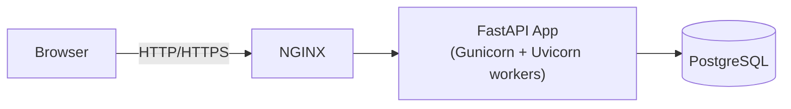

# Finora — Personal Finance Management Platform

Finora is a full-stack financial management platform: accounts, transactions,
transfers, budgets, dashboards, and reports, backed by PostgreSQL with a
FastAPI + Jinja2 server-rendered UI.

## Demo

https://github.com/user-attachments/assets/8dde6a5b-2624-45ea-9101-6f632a1a2f0b

## Table of Contents

- [Project Overview](#project-overview)
- [Features](#features)
- [Technology Stack](#technology-stack)
- [Architecture](#architecture)
- [Project Structure](#project-structure)
- [Installation](#installation)
- [Environment Variables](#environment-variables)
- [Local Development](#local-development)
- [Docker Setup](#docker-setup)
- [Database Migrations](#database-migrations)
- [Running Tests](#running-tests)
- [AWS Deployment](#aws-deployment)
- [NGINX Setup](#nginx-setup)
- [HTTPS](#https)
- [PostgreSQL Backup](#postgresql-backup)
- [Troubleshooting](#troubleshooting)
- [Security Notes](#security-notes)
- [Future Improvements](#future-improvements)

## Project Overview

Every user gets isolated accounts, transactions, categories, budgets, and
reports. Balances and dashboard statistics are always computed live from
PostgreSQL — never cached or hand-maintained — so they can't drift out of
sync with the underlying transaction history.

## Features

- Email/password auth with JWT (httpOnly cookie), bcrypt password hashing
- Multiple accounts (bank, cash, savings, credit card, wallet) with live balances
- Income/expense transactions with categories, search, filters, pagination
- Money transfers between accounts (atomic — can't leave the books unbalanced)
- Budgets per category per month with live safe/warning/critical status
- Dashboard with SQL-aggregated stats and Chart.js visualizations
- Reports with flexible date ranges (this month, last 3/6 months, custom, etc.)
- CSV export of transactions
- In-app notifications (budget alerts, large expenses, new accounts)
- Light/dark theme, fully responsive design
- Strict per-user data isolation enforced at the service layer

## Technology Stack

**Backend:** Python 3.12, FastAPI, SQLAlchemy 2.x, Alembic, PostgreSQL, Pydantic v2,
python-jose (JWT), passlib/bcrypt, Uvicorn + Gunicorn

**Frontend:** Jinja2 server-rendered HTML, vanilla JavaScript, Chart.js, hand-written CSS
design system (no build step, no framework dependency)

**Infra:** Docker, Docker Compose, NGINX, AWS EC2 (Free Tier compatible)

## Architecture



Request flow: NGINX terminates the connection and proxies everything to the
FastAPI app over Docker's internal network. The app is the *only* thing that
talks to PostgreSQL, and PostgreSQL's port is never exposed to the host or
the internet.

## Project Structure

```text
finora/
├── app/
│   ├── main.py                 # FastAPI app, middleware, exception handlers
│   ├── core/                   # config, database, security, deps, logging
│   ├── models/                 # SQLAlchemy models (one file per table)
│   ├── schemas/                # Pydantic request/response schemas
│   ├── api/                    # routers: auth, accounts, transactions, ...
│   ├── services/                # business logic, ownership checks
│   ├── templates/               # Jinja2 pages
│   └── static/{css,js}/         # design system + client JS
├── alembic/                    # migrations
├── tests/                      # pytest suite (runs against real Postgres)
├── scripts/seed_demo.py        # optional demo data (refuses to run in prod)
├── deploy/nginx.conf
├── Dockerfile
├── docker-compose.yml
├── .env.example
└── requirements.txt
```

## Installation

**Prerequisites:** Docker + Docker Compose plugin (recommended), or Python 3.12
and a local PostgreSQL 16 instance for running without containers.

```bash
git clone <your-repo-url> finora
cd finora
cp .env.example .env
# Edit .env: set SECRET_KEY, POSTGRES_PASSWORD, DATABASE_URL to match
```

Generate a strong secret key:

```bash
python3 -c "import secrets; print(secrets.token_urlsafe(48))"
```

## Environment Variables

See `.env.example` for the full list. Never commit a real `.env` — it's in
`.gitignore` — and never hardcode secrets in source.

| Variable | Purpose |
|---|---|
| `SECRET_KEY` | Signs JWTs — must be long, random, and secret |
| `DATABASE_URL` | SQLAlchemy connection string (`postgresql+psycopg://...`) |
| `JWT_EXPIRE_MINUTES` | Session length |
| `POSTGRES_*` | Used by the `postgres` container to initialize the DB |
| `COOKIE_SECURE` | Set to `true` once served over HTTPS |
| `CORS_ORIGINS` | Comma-separated list of allowed origins |
| `DEFAULT_CURRENCY` | Default for new users (`PKR`, `USD`, `EUR`, `GBP`) |

## Local Development

Without Docker, using a local PostgreSQL:

```bash
python3 -m venv venv
source venv/bin/activate
pip install -r requirements.txt

# point DATABASE_URL in .env at your local Postgres, then:
alembic upgrade head
uvicorn app.main:app --reload
```

Visit `http://localhost:8000`. Optionally seed demo data (dev only):

```bash
python scripts/seed_demo.py
# Logs in as demo@finora.app / DemoPass123
```

## Docker Setup

```bash
docker compose up -d --build
```

This starts PostgreSQL (internal only), the FastAPI app (runs `alembic
upgrade head` automatically on boot, then serves via Gunicorn), and NGINX on
port 80. Visit `http://localhost`.

```bash
docker compose down          # stop everything
docker compose down -v       # stop and also delete the Postgres volume
docker compose logs -f app   # tail app logs
```

PostgreSQL data persists in the `postgres_data` named volume across restarts.

## Database Migrations

```bash
# Create a new migration after changing a model:
alembic revision --autogenerate -m "describe your change"

# Apply migrations:
alembic upgrade head

# Roll back one revision:
alembic downgrade -1
```

Inside Docker: `docker compose exec app alembic upgrade head`.

Never modify the production schema by hand — always go through a migration.

## Running Tests

The test suite runs against a **real PostgreSQL database**, not SQLite, so
constraint and numeric-precision behavior matches production exactly.

```bash
# create a dedicated test database once:
createdb finora_test   # or: psql -c "CREATE DATABASE finora_test OWNER finora;"

pytest                  # or: pytest -v for verbose output
```

Tests cover registration/login, account and transaction CRUD (including that
balances are correctly reversed on edit/delete so nothing is double-counted),
atomic transfers, budget threshold logic, dashboard aggregation, and —
specifically — that one user can never read, edit, or delete another user's
data via any endpoint.

## AWS Deployment

Target: a single Free-Tier-eligible EC2 instance running Ubuntu, with Docker
Compose managing the app, Postgres, and NGINX containers.

1. **Launch EC2** — Ubuntu 24.04 LTS, `t2.micro` (Free Tier), at least 20GB gp3 storage.
2. **Configure Security Group** — inbound rules: `22` (SSH, your IP only),
   `80` (HTTP, anywhere), `443` (HTTPS, anywhere). Nothing else — see
   [NGINX Setup](#nginx-setup) for why 5432 and 8000 stay closed.
3. **SSH into the instance:**
   ```bash
   ssh -i your-key.pem ubuntu@<EC2_PUBLIC_IP>
   ```
4. **Install Docker:**
   ```bash
   curl -fsSL https://get.docker.com | sudo sh
   sudo usermod -aG docker $USER
   newgrp docker
   ```
5. **Install the Docker Compose plugin** (bundled with the Docker install
   above on recent versions; verify with):
   ```bash
   docker compose version
   ```
6. **Clone the repository:**
   ```bash
   git clone <your-repo-url> finora
   cd finora
   ```
7. **Configure `.env`:**
   ```bash
   cp .env.example .env
   nano .env
   # Set SECRET_KEY (see Installation), POSTGRES_PASSWORD, APP_ENV=production,
   # DEBUG=false, COOKIE_SECURE=false initially (true once HTTPS is live),
   # CORS_ORIGINS=http://<EC2_PUBLIC_IP> (or your domain)
   ```
8. **Build containers:**
   ```bash
   docker compose build
   ```
9. **Run migrations** — happens automatically on `app` container start, or
   run manually first:
   ```bash
   docker compose run --rm app alembic upgrade head
   ```
10. **Start the application:**
    ```bash
    docker compose up -d
    ```
11. **Configure NGINX** — already wired via `deploy/nginx.conf` and started
    as part of `docker compose up`. Adjust `server_name` once you have a domain.
12. **Configure firewall** — `ufw` as a second layer behind the Security Group:
    ```bash
    sudo ufw allow 22/tcp
    sudo ufw allow 80/tcp
    sudo ufw allow 443/tcp
    sudo ufw enable
    ```
13. **Verify the health endpoint:**
    ```bash
    curl http://localhost/health
    # {"status":"healthy","database":"ok"}
    ```
14. **Verify in browser:** visit `http://<EC2_PUBLIC_IP>`.
15. **View logs:**
    ```bash
    docker compose logs -f app
    docker compose logs -f nginx
    ```
16. **Restart the application:**
    ```bash
    docker compose restart app
    ```
17. **Backup PostgreSQL** — see [PostgreSQL Backup](#postgresql-backup).
18. **Update the application safely:**
    ```bash
    git pull
    docker compose build app
    docker compose up -d app   # migrations run automatically on start
    ```

**Moving to RDS later:** the app only cares about `DATABASE_URL`. Point it at
an RDS Postgres endpoint, remove the `postgres` service from
`docker-compose.yml`, and nothing else changes.

## NGINX Setup

NGINX is the only container with a published port (`80`, and `443` once
HTTPS is configured). It reverse-proxies everything to the `app` container
over Docker's internal network; `app` itself is never exposed to the host,
and `postgres` is never exposed at all. See `deploy/nginx.conf`.

## HTTPS

Once you have a domain pointed at the EC2 instance's IP:

```bash
# Install Certbot's standalone/nginx plugin on the host (not in Docker,
# to keep certificate renewal simple):
sudo apt-get update && sudo apt-get install -y certbot python3-certbot-nginx

# Stop the nginx container temporarily so Certbot can bind port 80:
docker compose stop nginx
sudo certbot certonly --standalone -d your-domain.com

# Mount the resulting certs into the nginx container (add to
# docker-compose.yml under nginx.volumes):
#   - /etc/letsencrypt:/etc/letsencrypt:ro

# Uncomment the HTTPS server block in deploy/nginx.conf, set server_name,
# then:
docker compose up -d nginx
```

Set `COOKIE_SECURE=true` in `.env` and restart the `app` container once HTTPS
is live, so the auth cookie is only ever sent encrypted.

Certbot's certificates auto-renew via its own systemd timer; add
`docker compose restart nginx` as a renewal hook so NGINX picks up the
renewed cert.

## PostgreSQL Backup

```bash
# Backup:
docker compose exec postgres pg_dump -U finora finora > finora_backup_$(date +%Y%m%d).sql

# Restore into a fresh database:
docker compose exec -T postgres psql -U finora finora < finora_backup_20260101.sql
```

Store backups off the instance (S3, or download via `scp`) — the Docker
volume alone is not a backup strategy, since it lives on the same disk as
everything else.

## Troubleshooting

- **`/health` reports `database: unreachable`** — check `docker compose logs
  postgres`, and confirm `DATABASE_URL` in `.env` matches the `POSTGRES_*`
  values.
- **502 from NGINX** — the `app` container probably isn't healthy yet or
  crashed on startup; check `docker compose logs app`.
- **Migrations fail on deploy** — run `docker compose run --rm app alembic
  upgrade head` manually to see the full error.
- **Can't connect from host to Postgres** — this is intentional; Postgres is
  only reachable from the `app` container. Use `docker compose exec postgres
  psql -U finora` to get a shell.

## Security Notes

- Passwords are hashed with bcrypt; never logged or stored in plaintext.
- JWTs are delivered as httpOnly, `SameSite=Lax` cookies; set `COOKIE_SECURE=true`
  in production over HTTPS.
- Every service-layer function that reads/writes a user-owned resource
  (accounts, transactions, budgets, notifications) checks `resource.user_id
  == current_user.id` before returning or mutating anything — verified by
  the cross-user isolation tests in `tests/test_user_isolation.py`.
- All monetary values use PostgreSQL `NUMERIC(14,2)` via SQLAlchemy — never
  floating point.
- PostgreSQL is never exposed outside the Docker internal network.
- CORS is restricted to the origins listed in `CORS_ORIGINS`.

## Future Improvements

- Recurring transactions / scheduled bills
- Multi-currency accounts with live exchange-rate conversion
- Shared/household accounts with multiple users
- PDF report export (CSV is implemented; PDF was left as a stretch goal)
- Rate limiting on auth endpoints
- OAuth/social login
